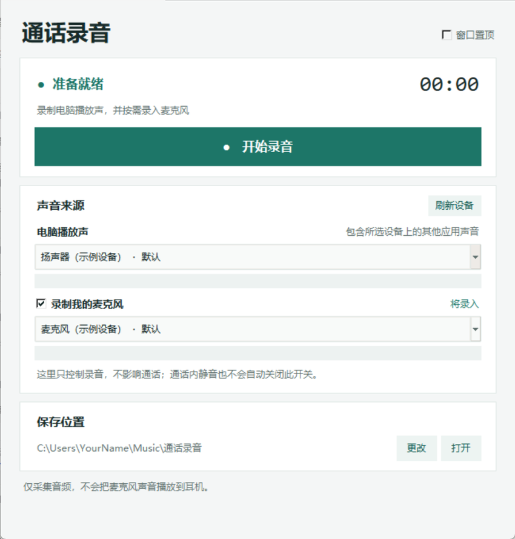

# 通话录音 · Call Recorder

一个面向 Windows x64 的本地桌面录音工具。它可以录下所选 Windows 播放设备正在输出的声音，并可同时录入麦克风，结果保存为 WAV 文件。

截图中的设备名称为示例，不代表特定设备。

## 安装

1. 前往 [GitHub Releases 下载最新版安装包](https://github.com/CJY019/call-recorder/releases/latest)，下载名称类似 `CallRecorder-Setup-0.1.0-x64.exe` 的文件。
2. 双击安装包，按提示安装。程序默认安装在当前用户目录，不需要管理员权限，也无需另行安装 Python。
3. 从开始菜单启动“通话录音”。安装时也可选择创建桌面快捷方式。

安装包当前没有代码签名证书，Windows 可能提示发行者未知。请从本项目的 GitHub Releases 下载，并按页面中的 SHA-256 校验值核对文件。

## 使用

1. 启动“通话录音”，确认“电脑播放声”列表中选中当前用于播放通话的设备。列表为空时，检查 Windows 声音设置后点“刷新设备”。
2. “录制我的麦克风”默认勾选。需要录入麦克风时，确认选中了正确的麦克风；不需要时取消勾选。也可以在录音过程中切换此选项。
3. 按需点击“更改”选择保存位置。默认保存到当前 Windows 账户主目录下的 Music\通话录音文件夹，程序会记住所选位置。
4. 点击“开始录音”。结束时点击“结束并保存”；等待状态显示“已保存”后即可在保存目录中打开 WAV 文件。

如果麦克风不可用，程序会提示并继续录制电脑播放声。若同一秒内已有同名文件，程序会在新文件名后追加序号，不覆盖已有录音。

正式使用前建议试录十秒并回放。如果听不到某一路，请确认通话软件使用的播放设备和本工具所选设备一致，并检查 Windows“隐私和安全性 → 麦克风”中的桌面应用访问权限。

## 录音范围与麦克风开关

程序通过 Windows WASAPI loopback 采集**所选播放设备输出的全部声音**，包括路由到该设备的其他应用声音；它不会只录某个会议或通话软件的声音。切换到另一台播放设备、或把通话声音路由到其他设备后，需要在录音开始前选中对应设备。

麦克风开关只决定麦克风声音是否写入录音文件。它不会改变 Windows 或通话软件里的麦克风静音状态，也不能自动识别或跟随通话软件内的静音按钮。通话软件静音时，请按需在本工具里单独关闭麦克风录入。

本程序只采集并写入文件，不把采集到的声音播放回耳机，也不开启声音侦听或回放。

## 文件格式与容量

录音为未压缩的 PCM WAV：48 kHz、双声道、16-bit。文件约占用 691 MB/小时（约 659 MiB/小时）。标准 RIFF/WAV 文件有约 4 GiB 的上限，按此格式约为 6 小时 13 分钟；达到上限时录音会结束，已写入的内容会保留，不会自动分卷。

## 支持系统与限制

当前安装包支持 Windows 10 1809 或更新版本、Windows 11 的 x64 环境，并依赖 Windows WASAPI。macOS 和 Linux 不受支持；其他 Windows 版本、特殊音频驱动和虚拟设备尚无兼容性保证。电脑播放声需要在 WASAPI 中可用；麦克风为可选来源。

录音涉及播放设备上的所有应用声音，请先确认录音范围合适，并确保录音使用符合适用规定且已取得所需同意。

## 测试范围

仓库中的自动化测试使用假音频设备和合成样本，覆盖部分设备选择、混音、WAV 写入和界面控制逻辑。它们不等同于真实声卡或真实通话场景的端到端测试，也没有覆盖所有 Windows 版本、驱动或安装包的兼容矩阵。本项目不据此宣称已在所有目标设备上验证通过。

## 从源码运行

需要 Windows x64 和 Python 3.13（也已在 3.12 上运行测试）。在项目根目录运行：

    py -3.13 -m venv .venv
    .\.venv\Scripts\python.exe -m pip install -r call_recorder\requirements.txt
    .\.venv\Scripts\python.exe -m call_recorder

运行不采集真实声音的自动测试：

    .\.venv\Scripts\python.exe -m unittest discover -s tests -v

安装包的构建方法见 [构建说明](packaging/BUILDING.md)。

## 许可

本项目代码按 MIT License 发布，详见 [LICENSE](LICENSE)。依赖项的许可与发行包中的第三方组件说明见 [THIRD_PARTY_NOTICES.md](THIRD_PARTY_NOTICES.md)。

